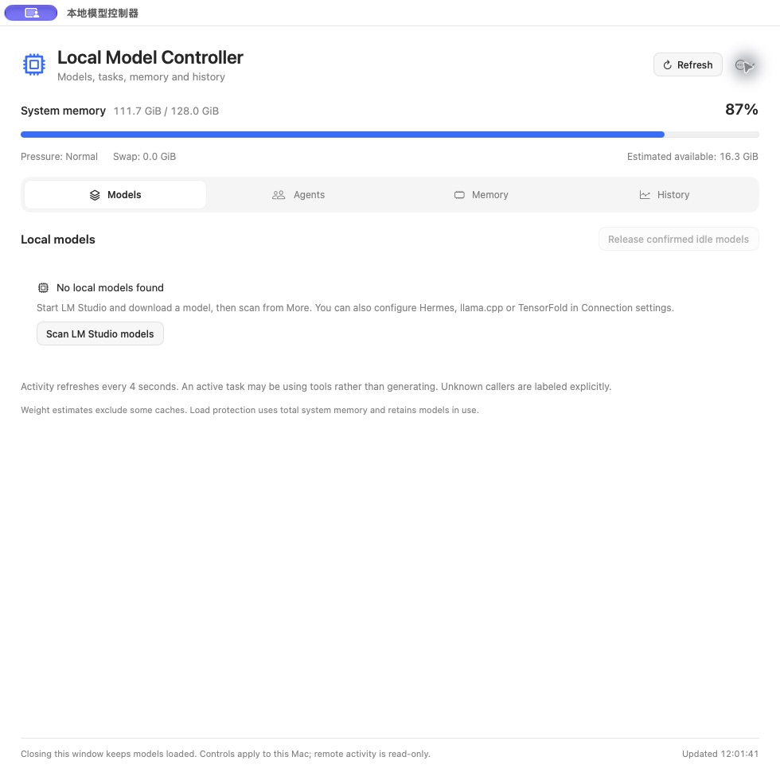

# Local Model Controller

[简体中文](README.zh-CN.md) · English · [Download preview](https://github.com/kentye747/local-model-controller/releases)

A small native macOS control panel for local models: see what is loaded, which agent is using it, how much memory is in use, and what completed requests actually cost in tokens and time.

Built with SwiftUI and a local Python bridge. No account, cloud service, prompt upload or analytics service is required.



Fresh-profile interface, with no model, task or history data.

## Download and open

1. Download the **Apple silicon** DMG from [Releases](https://github.com/kentye747/local-model-controller/releases).
2. Open the DMG and drag **Local Model Controller** to Applications.
3. Open the app. Use **More → Language / 语言** to choose English, 简体中文, or the system default.
4. Install an engine separately. With LM Studio, download models there, then choose **More → Rescan LM Studio models**.

The preview includes its Python runtime. End users do not need Terminal or a separate Python installation. Source builds require Xcode Command Line Tools and Python 3.12 or newer.

**Preview status:** this is an initial open-source preview, locally tested on an Apple silicon Mac. The downloadable build is ad-hoc signed and **not Apple notarized**; macOS may block it. Use only macOS's normal, user-approved opening flow in System Settings if available. Do not disable Gatekeeper. See [installation and limitations](docs/installation.md). Intel source builds are possible but are not claimed to be locally verified binary releases.

## What it does

- Load and release models through supported local engines, with fresh ownership and busy-state checks.
- Choose the default local model for **Hermes** and **DeepSeek Harness**; existing conversations may keep their own model.
- Display agent task names from native metadata. An uncertain caller stays uncertain rather than borrowing an unrelated title.
- Show system memory, swap and pressure, with a configurable budget for loads started in this app.
- Show input/output token rates when engines expose them. Missing values remain blank.
- Browse per-model history: tokens, duration-weighted average rates, recorded peak rates, P50/P95 latency, cache statistics and CSV exports.
- Offer Chinese and English UI, keyboard navigation, native dark/light appearance and motion respecting Reduce Motion.

## Integrations and honest limits

| Integration | Capabilities | Requirements / limits |
| --- | --- | --- |
| LM Studio | Inventory, load/release, API readiness, completed prediction statistics | Existing LM Studio + `lms`. Older CLI versions may require explicit confirmation before release. |
| Hermes / llama.cpp | Managed runtime identity and status, model control, active conversations | Hermes desktop APIs/layout vary. The managed endpoint reader is imported from the user's installation, never vendored. An explicit loopback llama.cpp router can be configured instead. |
| DeepSeek Harness | Default model configuration, local session activity, conversation navigation | Existing desktop app or configured source install. Conversation navigation needs optional macOS Accessibility permission and can break when the external app UI changes. |
| TensorFold | Lifecycle and telemetry through an optional command adapter | **Disabled by default.** Requires a user-provided adapter with the documented status contract; no universal TensorFold CLI is assumed. |
| Remote Mac | Read-only Hermes activity through existing SSH forwarding and a metadata probe | **Disabled by default.** Explicit SSH alias/hostname/probe setup required. The bundled generic probe does not include any business gateway or scheduling code. |

This is a macOS controller, not an inference engine or model installer. It does not install weights, start external apps during status polling, change an active conversation's model, or guarantee identification of every API client. Weight estimates do not include every KV cache or allocation. A model operation can affect other software sharing that model; confirmed active requests are protected, while incomplete engine metadata still has practical limits.

## Configuration

Choose **More → Connection settings** to create/open your local JSON configuration. It lives at:

```text
~/Library/Application Support/Local Model Controller/settings.json
```

Use [settings.example.json](settings.example.json) as a field reference, not as a drop-in list of paths for every Mac. Defaults discover common locations. Restart the controller after changing connection settings. No engine is restarted by that action. API credentials belong in your local environment or native engine configuration, never in this repository.

More details: [configuration and adapters](docs/configuration.md), [privacy](docs/privacy.md), [translation guide](docs/localization.md), [contributing](CONTRIBUTING.md).

## Build and verify

```sh
python3.12 -m venv .venv
.venv/bin/python -m pip install -r requirements-build.txt
.venv/bin/python -m unittest discover -p 'test_*.py'
./build.sh
```

The generated app is `dist/Local Model Controller.app`; building does not replace an installed app or change agent settings. Build on the architecture you intend to distribute. [PyInstaller](https://pyinstaller.org/en/stable/usage.html) freezes the local bridge and its dependencies; the SwiftUI frontend remains native.

```sh
"dist/Local Model Controller.app/Contents/MacOS/LocalModelControl" --check-localization
"dist/Local Model Controller.app/Contents/MacOS/LocalModelControl" --check-status
"dist/Local Model Controller.app/Contents/MacOS/LocalModelControl" --check-history
```

Status/history checks read local metadata and may import numeric engine logs into the local history database. They do not send inference requests. To test against a clean profile, set `LMC_HOME`, `LMC_DATA_DIR` to temporary directories and `LMC_DISABLE_HERMES=1`. Tests use temporary fixtures and do not load or release real models.

## Privacy and licensing

The app does not send prompts, responses, task names or statistics to an online service. It may **read** local engine logs to extract numeric metrics; those logs can contain sensitive content, so they are never included in bug reports automatically. History stores model identifiers, numeric statistics and provenance, not prompt/response bodies or task titles. SSH is used only if configured by the user.

MIT for the controller's own code. External engines, agents, models and dependencies retain their own licenses. See [LICENSE](LICENSE) and [third-party notices](THIRD_PARTY_NOTICES.md). This independent project is not affiliated with those products.
