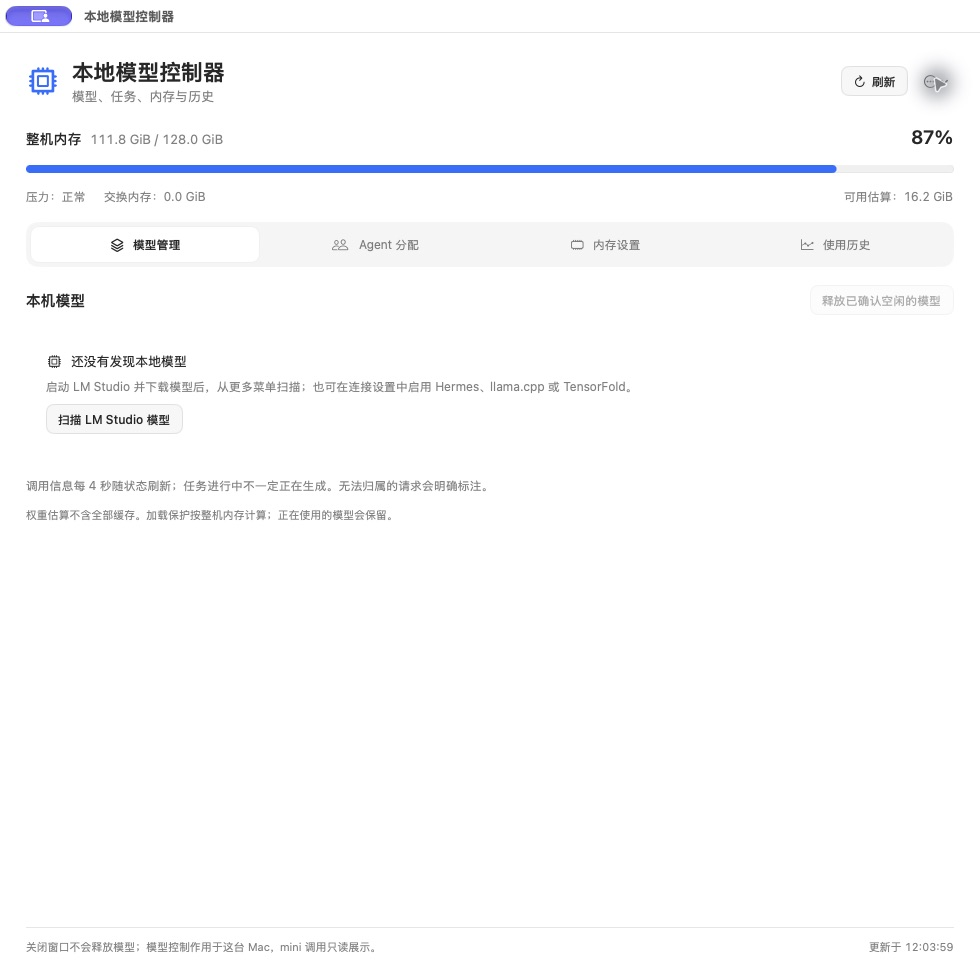

# 本地模型控制器

简体中文 · [English](README.md) · [下载预览版](https://github.com/kentye747/local-model-controller/releases)

一个原生 macOS 小工具：查看本地模型是否加载、正在被哪个 Agent 使用、内存占用，以及已结束请求的 token 用量与速度。

SwiftUI 原生界面，本地 Python 桥接。不需要账号或云服务，不上传提示词和回复。



隔离配置下的真实空状态界面，不含聊天、任务或历史资料。

## 图形界面安装

1. 在 [Releases](https://github.com/kentye747/local-model-controller/releases) 下载 **Apple silicon** 版 DMG。
2. 打开磁盘映像，把 **Local Model Controller** 拖到“应用程序”。
3. 打开应用，在 **更多 → 语言 / Language** 选择中文、英文或跟随系统。
4. 模型引擎单独安装。使用 LM Studio 时，先在 LM Studio 下载模型，再从“更多”重新扫描。

安装包自带 Python，日常使用无需终端。源码构建需要 Xcode 命令行工具和 Python 3.12 或更新版本。

**这是首个开源预览版。** 下载包在 Apple silicon Mac 上完成本地验证，使用临时签名，**未通过 Apple 公证**，macOS 可能阻止打开。需要时由本人使用系统提供的正常允许打开流程，不要关闭 Gatekeeper。Intel 可自行从源码构建，目前不声称已在 Intel 实机验收。

## 能做什么

- 查看、加载、释放模型，操作前重新核验归属和请求状态。
- 为 Hermes、DeepSeek Harness 保存默认本地模型；已有对话可能保留自己的选择。
- 从原生元数据展示 Agent 任务；无法确认时明确标注，不套用其他对话标题。
- 查看整机内存、交换内存和压力，为控制器发起的加载设置保护预算。
- 查看引擎真实提供的输入、输出速度；没有数据时保留横线。
- 按模型和日期查看历史 token、加权平均速度、已记录最高速度、P50/P95、缓存与请求明细，导出 CSV。
- 中英文界面、键盘快捷键、系统明暗外观和可关闭的轻盈动效，尊重“减少动态效果”。

## 接入范围

| 软件 | 接入内容 | 条件 |
| --- | --- | --- |
| LM Studio | 模型列表、加载释放、API 状态、已完成请求统计 | 已安装 LM Studio 和可用的 `lms`；旧版无法提供可靠空闲状态时需要单独确认释放。 |
| Hermes / llama.cpp | 运行时状态、模型控制、活动对话 | 使用 Hermes 本机原生接口；不同版本布局可能变化。也可配置本机回环地址上的 llama.cpp 路由服务。 |
| DeepSeek Harness | 默认模型、任务元数据、对应对话定位 | 已安装桌面版或配置源码版；定位对话可能需要辅助功能授权。 |
| TensorFold | 可选生命周期与统计适配器 | **默认关闭**。需要用户提供符合契约的命令适配器，不假设所有 TensorFold 安装都有相同 CLI。 |
| 远程 Mac | SSH 下只读识别 Hermes 活动任务 | **默认关闭**。需明确配置 SSH、主机身份、转发和探针；不附带业务网关、任务调度或客户资料。 |

控制器不负责安装权重，也不能保证识别全部 API 调用方。内存估算不包含全部缓存；操作共享模型可能影响使用它的其他软件。具体兼容条件及限制见 [英文说明](README.md#integrations-and-honest-limits)。

## 连接与语言设置

“更多 → 打开连接设置”会创建或打开本机文件：

```text
~/Library/Application Support/Local Model Controller/settings.json
```

参考 [配置示例](settings.example.json)，只填写你实际使用的集成。修改连接设置后重启控制器即可，不会重启模型引擎。历史数据库保留在同一目录，不随应用升级重置。

语言菜单可直接切换，重开后保留。新增语言可以扩展 `locales/` 目录，见 [翻译指南](docs/localization.md)。

## 开发与验证

```sh
python3.12 -m venv .venv
.venv/bin/python -m pip install -r requirements-build.txt
.venv/bin/python -m unittest discover -p 'test_*.py'
./build.sh
```

生成 `dist/Local Model Controller.app`，不会自动覆盖当前安装或修改 Agent 默认配置。构建产物、个人配置、聊天和历史库均不进入 Git。

[安装说明](docs/installation.md) · [配置与适配器](docs/configuration.md) · [隐私说明](docs/privacy.md) · [参与贡献](CONTRIBUTING.md)

控制器自身代码使用 MIT 许可；引擎、Agent、模型权重与依赖维持各自许可。详情见 [LICENSE](LICENSE) 与 [第三方声明](THIRD_PARTY_NOTICES.md)。
